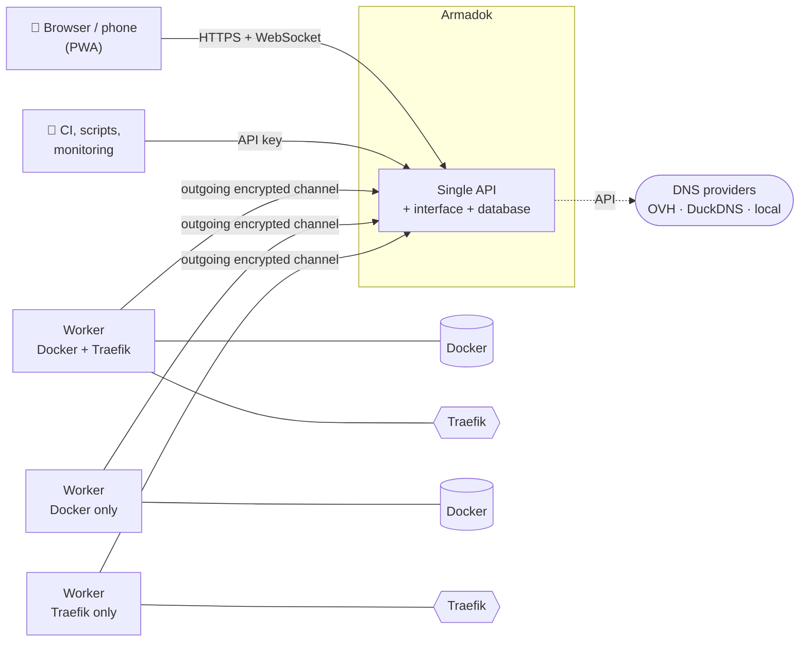
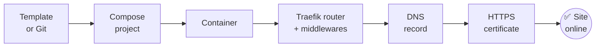
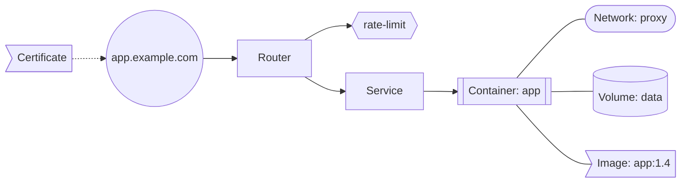

<a id="top"></a>
<!-- Keep this file and README.fr.md in sync: same sections, same order. -->

<div align="center">

[Home](README.md) · [Français](README.fr.md) · **English**

<!--
Logo (to add once it exists — monochrome SVG that follows the text colour):
<picture>
  <source media="(prefers-color-scheme: dark)" srcset="docs/assets/logo-dark.svg">
  <source media="(prefers-color-scheme: light)" srcset="docs/assets/logo-light.svg">
  
</picture>
-->

# Armadok

**Your Docker, Traefik and DNS infrastructure in a single interface.**

Deploy your applications, publish them over HTTPS, attach their domain name,<br>and see at a glance what is connected to what.


<!--
Dynamic badges — enable once the repository is public:
[](https://github.com/Dr-J-Watson/armadok/actions/workflows/ci.yml)
[](https://github.com/Dr-J-Watson/armadok/releases)
[](https://github.com/Dr-J-Watson/armadok/pkgs/container/armadok)
[](https://github.com/Dr-J-Watson/armadok)
-->

<kbd>[Features](#overview)</kbd>
<kbd>[Relationship map](#relationship-map)</kbd>
<kbd>[First start](#first-start)</kbd>
<kbd>[API](#api)</kbd>
<kbd>[Security](SECURITY.md)</kbd>

</div>

> [!NOTE]
> **Status: in design.** This page describes the scope of the first release.

---

## Contents

<details>
<summary><b>Show the table of contents</b></summary>

- [Overview](#overview)
- [How it fits together](#how-it-fits-together)
- [Applications and Docker Compose projects](#applications-and-docker-compose-projects)
- [Git and automatic updates](#git-and-automatic-updates)
- [Docker on your nodes](#docker-on-your-nodes)
- [Traefik](#traefik)
- [Traffic statistics and logs](#traffic-statistics-and-logs)
- [Conversions](#conversions)
- [HTTPS certificates](#https-certificates)
- [DNS](#dns)
- [Relationship map](#relationship-map)
- [Nodes and workers](#nodes-and-workers)
- [Team, rights and security](#team-rights-and-security)
- [Notes and reminders](#notes-and-reminders)
- [Notifications](#notifications)
- [Interface](#interface)
- [Real time](#real-time)
- [API](#api)
- [First start](#first-start)
- [Backups and operations](#backups-and-operations)
- [Roadmap](#roadmap)

</details>

---

## Overview

<table>
  <tr>
    <td width="33%" valign="top">

### 🚀 Deploy
Docker Compose projects, ready-made templates, Git, automatic image updates, live logs and terminal.

  </td>
    <td width="33%" valign="top">

### 🌐 Publish
Traefik sites and middlewares, HTTPS certificates, DNS records — from one screen, with the traffic of every app.

  </td>
    <td width="33%" valign="top">

### 🕸️ Understand
An interactive map of what is connected to what: containers, sites, domains, volumes, networks.

  </td>
  </tr>
  <tr>
    <td width="33%" valign="top">

### 👥 Share
Teams, roles, fine-grained time-limited rights, private notes, signed audit log.

  </td>
    <td width="33%" valign="top">

### 🖥️ Scale
Many nodes driven from one interface, with no port to open.

  </td>
    <td width="33%" valign="top">

### 🔌 Integrate
One API, personal keys and service accounts with rights down to the single permission.

  </td>
  </tr>
</table>

---

## How it fits together



From a template or a Git repository to a site that answers over HTTPS:



---

## Applications and Docker Compose projects

A project is a plain folder on disk (`docker-compose.yml`, `.env`, Dockerfiles). The disk remains the source of truth: Armadok runs `docker compose` on it, and nothing is rewritten until you import it.

- **Discovery** of compose files in your folders, one-click import (managed / ignored), adoption of containers that are already running.
- **Actions**: start, stop, restart, recreate, `pull`, `build` (with or without cache), `down`, per project or per service, with **live** output and an operation history.
- **Editor** (Monaco) for compose, `.env`, Dockerfiles and build-context files: `docker compose config` validation, diff before saving, history and restore, detection of changes made elsewhere.
- **Build analysis**: missing `ARG`s, `COPY` of a missing file, context outside the sources, stale builds.
- **Templates**: PostgreSQL, Redis, MariaDB + phpMyAdmin, Vaultwarden, Uptime Kuma, nginx, generic web application… with generated secrets. Save any of your projects as a template.
- Live **logs**, CPU / memory / network **statistics** and a **terminal** inside containers.
- **Application page**: project, containers, logs, sites, domain, certificate, traffic and last deployment in one place.

<p align="right"><a href="#top">⬆ back to top</a></p>

## Git and automatic updates

- A project follows a **GitHub, GitLab, Gitea / Forgejo or Bitbucket** repository (generated SSH deploy key or access token) or is cloned from the interface.
- **Automatic redeploy** through a signed GitHub webhook and/or polling; **targeted** rebuild of only the affected services.
- **Safe by default**: only a fast-forward is applied automatically; a diverged history or conflicting local changes stop the sync and nothing is overwritten.
- **Deployment history** and **rollback to a commit**.
- **Image tracking**: new versions detected by comparing digests with the registry, without downloading anything; notification or scheduled automatic update, service by service; **rollback** available; **private registry credentials** managed in the interface.
- **Post-deployment check**: does the site answer? If not, an **automatic rollback is offered** (never enabled by default).

## Docker on your nodes

- All containers (including those outside any project), images, networks and volumes: start, stop, restart, remove, prune, inspect.
- Which image, network or volume is used by what; sizes; read-only browsing inside a volume.
- Live logs, statistics and terminal; debug terminal for containers without a shell.
- **Node resources**: processor, memory, disks, network, temperature, GPU.
- **Known vulnerabilities (CVEs) in your images**: per image, project and container, with the version that fixes them; containers that are vulnerable **and** published through Traefik are highlighted.
- **Volume backup and restore** (archive, schedule, retention) and **scheduled tasks**: timed restarts, cleanup, backups.

## Traefik

Two modes, chosen per platform, node or application: **dynamic files** or **Docker labels**.

**Sites**
- Block-based builder: *When visiting… → Then apply… → Then send to… → HTTPS → DNS*.
- A site's target is picked from the **real containers** (name, port, network).
- **Reversible pause** of a site, an element, a file or a whole domain; dependencies follow, with a preview before you confirm.
- Live router status, confirmation that Traefik reloaded the configuration.

**Advanced elements**
- Routers, services, middlewares, transports, TLS options and stores, for **HTTP, TCP and UDP**.
- Forms generated from the **Traefik v3** catalogue, YAML editor, diff, history and restore.
- `htpasswd` generator, **cascading rename** (every reference follows), **consistency analysis** (broken references, duplicates, loops).
- Your files' comments and formatting are preserved.

> [!TIP]
> Not sure which middleware you need? Create one **by intent**: *local network only*, *ask for a password*, *single sign-on*, *security headers*, *rate limit*, *HTTPS redirect*… Armadok picks sensible defaults and only shows the essential fields.

<details>
<summary><b>Middleware catalogue (HTTP and TCP)</b></summary>

| Group | Middlewares |
|---|---|
| **Security and access** | `basicAuth`, `digestAuth`, `forwardAuth`, `ipAllowList`, `passTLSClientCert`, `headers` (CORS, HSTS, CSP, X-Frame…) |
| **Redirects and paths** | `addPrefix`, `stripPrefix`, `stripPrefixRegex`, `replacePath`, `replacePathRegex`, `redirectScheme`, `redirectRegex` |
| **Requests and responses** | `compress`, `contentType`, `buffering`, `errors`, `chain`, `grpcWeb` |
| **Resilience and traffic** | `rateLimit`, `inFlightReq`, `retry`, `circuitBreaker` |
| **Advanced** | `plugin` |
| **TCP** | `ipAllowList`, `inFlightConn` |

</details>

**Files**
- Tree view, import and drag and drop, download, every version saved.
- **Reloads handled for you**: dynamic files picked up automatically, sub-folders through a reload file, labels through recreation of the service, static configuration editable with a confirmed restart.
- **Tidy-up assistant**: one file per site, or per router and service, sub-folders by domain and by type, safety copy before applying.

## Traffic statistics and logs

- **Guided activation** of Traefik's Prometheus metrics and access log: the assistant generates the configuration (static file or command-line arguments), tests it and shows the state of the collection.
- **Per application, site and domain**: requests per second, 2xx / 3xx / 4xx / 5xx breakdown, error rate, p50 / p95 / p99 latency, bytes exchanged, server health, failed configuration reloads.
- **IP address lists**[^prom]: who connects to each application, how many requests and errors, from which country; new IPs flagged; filterable live log.
- **Detection** of brute force, path scanning and traffic spikes; alerts through every channel.
- **Availability**: HTTP / TCP probes of your sites, history, alerts and an optional public status page.
- **Built in**: no Prometheus server to install (reading an existing Prometheus remains possible); collection is done by the worker and stored by Armadok. The thickness of links on the [relationship map](#relationship-map) reflects traffic.
- **Privacy-aware**: separate rights for statistics, logs and IP addresses; anonymisation available; sensitive headers never kept; adjustable retention; local geolocation, nothing is sent to a third party.

[^prom]: Traefik's Prometheus metrics never contain visitors' IP addresses; the IP lists come from Traefik's JSON access log. Armadok enables and combines both.

## Conversions

- **Dynamic file → Docker labels** and **labels → dynamic file**, for one site, one project or a batch, with a preview and the list of what cannot be converted cleanly.
- **`docker run` → `docker-compose.yml`**: from a container that is already running or from a pasted command. Secrets go into a `.env`, and the project can be adopted and managed.

<details>
<summary><b>Example: from a pasted <code>docker run</code> to a project</b></summary>

```diff
- docker run -d --name whoami -p 8080:80 -e TZ=Europe/Paris --restart unless-stopped traefik/whoami
+ services:
+   whoami:
+     image: traefik/whoami
+     container_name: whoami
+     ports:
+       - "8080:80"
+     environment:
+       TZ: Europe/Paris
+     restart: unless-stopped
```

</details>

## HTTPS certificates

- Tracking of Traefik's certificates: domains, issuer, expiry, wildcards, sites that did not get a certificate, an HTTPS badge on every site.
- **Private keys never leave the node** that holds them; only public information is displayed and stored.
- Help configuring the DNS challenge for the chosen provider (environment variables and Traefik snippet), wildcard certificate; certificates are obtained by Traefik (ACME, for example Let's Encrypt).
- Alerts before expiry.

## DNS

| Provider | What Armadok does |
|---|---|
| **OVH** | Full zone: records of every type, import / export, history and restore, SOA, **DNSSEC**, several accounts |
| **DuckDNS** | One IPv4 / IPv6 address and one TXT per name, sub-domains follow, "public IP of this server" button |
| **Local DNS** | Pi-hole, AdGuard, router… the domain is just a name for sites and rights; nothing is published |

The architecture is designed so more providers can be added.

- Search, multi-select, batch operations; each user can connect their own accounts, encrypted in the database.
- **Domain sharing** with restrictions: record types, sub-domains, deletion forbidden, limited duration.
- **Link with Traefik**: a host used by a site but missing from DNS is flagged with a button to create it; a record without a site can become a site in one click.

## Relationship map

An interactive bubble diagram showing **what is connected to what**: containers, projects, Traefik routers, services and middlewares, domains and DNS records, certificates, networks, volumes, images and nodes.



<sub>Simplified example of the links the map draws.</sub>

- The state of every element in colour (stopped, in error, DNS missing, certificate close to expiry, update available, critical vulnerability).
- Orphans spotted (unused volume, container without a site, site without a container…).
- Hover, click for the details and actions, filters, search, grouping by project or by node, saved layout, image export.
- Live updates; everyone's rights are respected. Phone-friendly version.
- **Everything is linked**: from a container, jump to its project, the Traefik rules that target it, its DNS domain or its certificate — and back. Every page has a "Relations" panel, and every object named anywhere (log, audit, notification, error) is clickable.

## Nodes and workers

- A node is a server managed by Armadok, of type **network** (Traefik, DNS), **Docker**, or **full**. The type determines the menus, the rights and the allowed operations.
- One **worker** per node, installed by an assistant: a ready-to-copy command, or a compose stack ready to paste into Portainer. **Remote update**: pull the new image and redeploy from the interface.
- The worker **connects out to the interface itself**: no port to open, nodes behind NAT are fine.
- **Encrypted, authenticated** channel end to end, interface key pinned, single-use 15-minute enrolment token.
- The worker runs only a **closed list of operations**, only inside its allowed folders.
- Each node has its owner, its members and its rights; transfer, suspension, worker replacement and revocation; **read-only mode**.

## Team, rights and security

> [!IMPORTANT]
> Armadok drives the Docker daemon, which is equivalent to root access on the node. Restrict access to the interface (IP allow-list, SSO, VPN) and enable two-factor authentication.
>
> The right to deploy combined with the right to edit project files gives the same power on that node. On the node that runs the hub, it also reaches the hub's own data folder (database and keys). Grant both rights sparingly.

**Fine-grained rights**
- A single rights catalogue covering Docker, Git, Traefik, DNS, traffic, notes and administration.
- Built-in (duplicable) and custom **roles**, **groups**, **assignments** to a person or a group on a node, all my nodes, a project, a label or a domain.
- **Temporary rights** with an expiry date, rights added or removed per member.
- Safeguards: you can never give more rights than you hold; an element you cannot see does not exist.
- A "who can do what?" screen per project, site and domain.

**Authentication**
- Short sessions with rotating renewal; a replayed old token revokes all sessions (theft detected).
- **Two-factor authentication** (TOTP) with backup codes.
- Progressive lockout of attempts; disabling an account takes effect immediately.

**Platform administration**
- An administrator has **no implicit access** to the content of other people's nodes.
- **Emergency access**: mandatory reason, 2FA, 30-minute session; the owner receives a notice they can acknowledge but never erase, with the list of actions taken.
- **Quick actions**: suspend, cut a worker, ban, delete (recoverable for 30 days), restore.

**Armadok's own vulnerability watch**
- Armadok knows the exact list of its components (libraries, web interface, base system, bundled tools, workers) and compares it every day with a **local** vulnerability database.
- The **super-administrator is notified** as soon as a flaw affects one of them, through every channel (browser included): component, severity, fixing version, available Armadok update. Reminders without spam, statuses, justified exceptions traced in the audit.

**Data**
- Secrets encrypted in the database, never sent back to the browser.
- Full **audit log** (who, what, where, when), signature-chained: any tampering is detectable and verifiable from the interface; JSON / CSV export and **syslog** forwarding.
- Container without superfluous privileges, confined paths, no secret in the logs.

## Notes and reminders

- A **note** field on every object: node, project, container, site, middleware, domain, record, certificate, user…
- **Entirely private** notes, including from administrators.
- **Reminders** with a due date, snooze, "done" checkbox; a "My notes" page with search.
- Notes follow renames and appear on the relationship map.

## Notifications

- Channels: **browser** (even with the tab closed), Discord, ntfy, signed webhook, e-mail.
- **Highly customisable**: event by event, scope (node, project, label, domain), minimum severity, "do not disturb" time ranges, grouping, anti-repeat, displayed content, actions in the notification, fallback channel.
- Filtered by your rights, in your account's language, with no sensitive data.

<details>
<summary><b>Events you can subscribe to</b></summary>

- Deployments (succeeded / failed), image updates (available / applied)
- Container stopped or in error, Traefik router in error
- Certificate close to expiry or expired, missing DNS, site unavailable
- Abnormal error rate or latency, brute force detected, vulnerability (CVE) in an image, vulnerability affecting an Armadok component (super-administrator)
- Worker disconnected / reconnected, emergency access opened on my node
- Right granted / expired, note reminder, backup succeeded / failed

</details>

## Interface

- **Desktop and phone**: adapted layout, tables that turn into cards, editor and terminal usable by touch, installable app (PWA).
- **English and French**, chosen per account; dates, numbers and plurals adapted.
- Light, dark, system or **custom** themes.
- <kbd>Ctrl</kbd> + <kbd>K</kbd> command palette: search across projects, containers, sites, domains and notes.
- Global dashboard: what needs your attention.
- Built-in help on technical terms.

<details>
<summary><b>What the browser remembers (preferences only, never secrets)</b></summary>

- Last page opened, per tab and overall; current node; sub-tabs
- Filters, sort order, visible columns, expanded sections, panel widths
- Map position, zoom and filters
- Unsaved drafts (restored with a warning if the file changed meanwhile)
- Recent items and favourites of the command palette
- Theme, language, text size, reduced motion
- A "My local preferences" page to see, export or erase it all

</details>

## Real time

- A single WebSocket channel: the screen updates by itself when something changes, even elsewhere.
- **Live progress** of every long operation: deployment, build, conversion, tidy-up, zone import.
- A warning when someone else edits the element you are editing.
- Automatic reconnection with catch-up.

## API

- A **single API** for everything: projects, Docker, Traefik, DNS, certificates, traffic, rights, notes, audit. The interface and the workers use nothing but this API.
- **Plug in other tools**: personal keys or **service accounts** (CI/CD, monitoring, home automation, scripts), created in a few clicks.
- **Rights down to the single permission**, as for people: each key gets only what it needs, on a specific node, project, label or domain, with expiry, read-only mode, allowed IP addresses and rate limits. Sensitive rights are excluded by default.
- Keys shown once, stored as a hash, zero-downtime rotation, instant revocation, unusual-usage alerts, audit of every call.
- Versioned API with **interactive OpenAPI documentation**, event stream, **signed webhooks**, minimal-scope **inbound hooks**, Prometheus metrics and an official **CLI**.

## First start

A browser-based assistant, no file to edit:

1. Creation of the **super-administrator** (protected by a single-use install code) and 2FA activation.
2. First node: type, project folders, Traefik folder, Docker access.
3. **Traefik**: version detection, **entrypoints**, **cert resolvers**, `acme.json`, shared network, metrics and access log.
4. **Certificates** and **DNS**: providers, credential test, zone import.
5. Default Traefik mode, notifications, backups.
6. End-to-end test: Traefik reachable, DNS resolves, certificate obtained.

Everything stays editable afterwards in the settings.

## Backups and operations

- Automatic daily backup of the whole state, one-command restore.
- Guided installation of the interface and the workers with a single `make`, update, status, logs.
- Multi-architecture images (amd64, arm64), versions numbered automatically from commit messages.

## Roadmap

**First release**

- [ ] Docker Compose projects, Git (GitHub, GitLab, Gitea / Forgejo, Bitbucket), image tracking *(Compose projects done; Git and image tracking to come)*
- [x] Volume backups, scheduled tasks, availability monitoring *(the public status page is still to come)*
- [ ] Traefik sites, middlewares, pause, conversions *(sites, ready-made middlewares and the configuration check done; cascading rename, tidy-up assistant, Docker-label mode, static configuration and conversions to come)*
- [ ] DNS (OVH, DuckDNS, local) and the link with Traefik
- [ ] Certificates and traffic statistics *(certificates done; traffic statistics to come)*
- [x] Relationship map
- [x] Nodes, workers, rights, audit
- [ ] Vulnerability (CVE) watch for Armadok and your images *(Armadok's Python packages and Debian, Ubuntu and Alpine container images done; web packages to come)*
- [x] Notes (private, optionally shared read-only), notifications, search, installable app, help page, English and French *(browser push to come)*
- [x] API keys, integrations, Prometheus metrics and CLI

---

<div align="center">

[⬆ back to top](#top) · [Security](SECURITY.md) · [Contributing](CONTRIBUTING.md) · [Changelog](CHANGELOG.md) · [MIT License](LICENSE)

</div>
