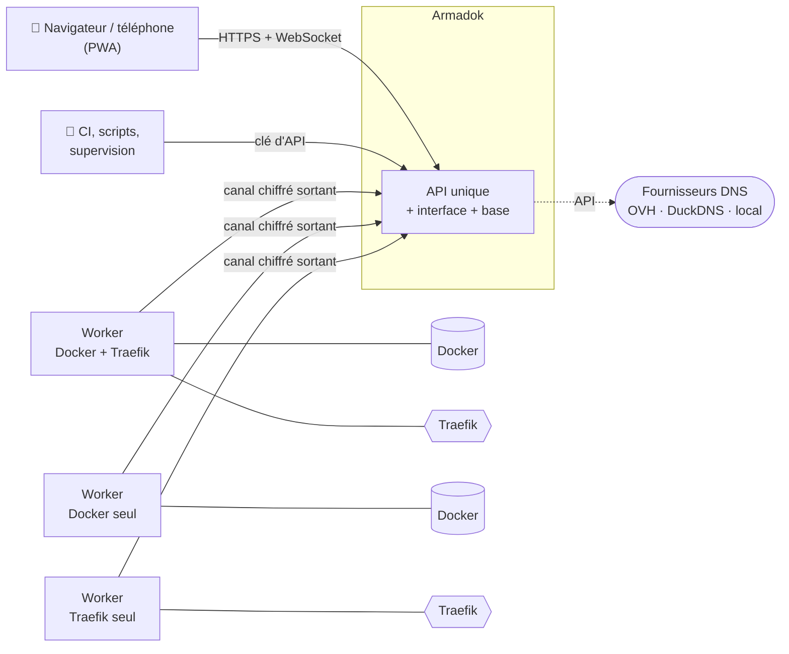
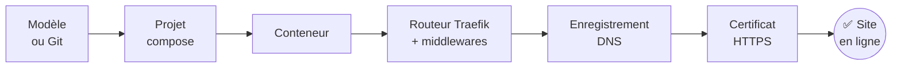
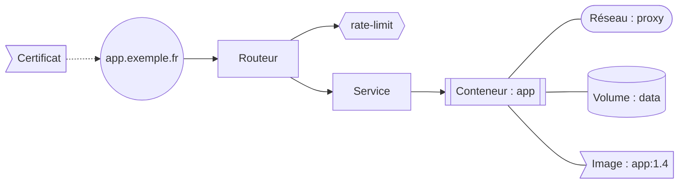

<a id="top"></a>
<!-- Garder ce fichier et README.en.md synchronisés : mêmes sections, même ordre. -->

<div align="center">

[Accueil](README.md) · **Français** · [English](README.en.md)

<!--
Logo (à ajouter quand il existera — SVG monochrome qui suit la couleur du texte) :
<picture>
  <source media="(prefers-color-scheme: dark)" srcset="docs/assets/logo-dark.svg">
  <source media="(prefers-color-scheme: light)" srcset="docs/assets/logo-light.svg">
  
</picture>
-->

# Armadok

**Votre infrastructure Docker, Traefik et DNS dans une seule interface.**

Déployez vos applications, publiez-les en HTTPS, branchez leur nom de domaine,<br>et voyez d'un coup d'œil qui est relié à quoi.


<!--
Badges dynamiques — à activer quand le dépôt sera public :
[](https://github.com/Dr-J-Watson/armadok/actions/workflows/ci.yml)
[](https://github.com/Dr-J-Watson/armadok/releases)
[](https://github.com/Dr-J-Watson/armadok/pkgs/container/armadok)
[](https://github.com/Dr-J-Watson/armadok)
-->

<kbd>[Fonctionnalités](#vue-densemble)</kbd>
<kbd>[Carte des relations](#carte-des-relations)</kbd>
<kbd>[Premier démarrage](#premier-démarrage)</kbd>
<kbd>[API](#api)</kbd>
<kbd>[Sécurité](SECURITY.md)</kbd>

</div>

> [!NOTE]
> **Statut : en conception.** Cette page décrit le périmètre de la première version.

---

## Sommaire

<details>
<summary><b>Afficher le sommaire</b></summary>

- [Vue d'ensemble](#vue-densemble)
- [Comment tout s'articule](#comment-tout-sarticule)
- [Applications et projets Docker Compose](#applications-et-projets-docker-compose)
- [Git et mises à jour automatiques](#git-et-mises-à-jour-automatiques)
- [Docker des machines](#docker-des-machines)
- [Traefik](#traefik)
- [Statistiques et journaux du trafic](#statistiques-et-journaux-du-trafic)
- [Conversions](#conversions)
- [Certificats HTTPS](#certificats-https)
- [DNS](#dns)
- [Carte des relations](#carte-des-relations)
- [Machines et workers](#machines-et-workers)
- [Équipe, droits et sécurité](#équipe-droits-et-sécurité)
- [Notes et pense-bêtes](#notes-et-pense-bêtes)
- [Notifications](#notifications)
- [Interface](#interface)
- [Temps réel](#temps-réel)
- [API](#api)
- [Premier démarrage](#premier-démarrage)
- [Sauvegardes et exploitation](#sauvegardes-et-exploitation)
- [Feuille de route](#feuille-de-route)

</details>

---

## Vue d'ensemble

<table>
  <tr>
    <td width="33%" valign="top">

### 🚀 Déployer
Projets Docker Compose, modèles prêts à l'emploi, Git, mises à jour d'images automatiques, logs et terminal en direct.

  </td>
    <td width="33%" valign="top">

### 🌐 Publier
Sites et middlewares Traefik, certificats HTTPS, enregistrements DNS — depuis un seul écran, avec le trafic de chaque application.

  </td>
    <td width="33%" valign="top">

### 🕸️ Comprendre
Une carte interactive de ce qui est relié à quoi : conteneurs, sites, domaines, volumes, réseaux.

  </td>
  </tr>
  <tr>
    <td width="33%" valign="top">

### 👥 Partager
Équipe, rôles, droits fins à durée limitée, notes privées, journal d'audit signé.

  </td>
    <td width="33%" valign="top">

### 🖥️ Étendre
Plusieurs machines pilotées depuis une seule interface, sans port à ouvrir.

  </td>
    <td width="33%" valign="top">

### 🔌 Intégrer
Une API, des clés personnelles et des comptes de service avec des droits au droit près.

  </td>
  </tr>
</table>

---

## Comment tout s'articule



D'un modèle ou d'un dépôt Git à un site qui répond en HTTPS :



---

## Applications et projets Docker Compose

Un projet est un simple dossier sur disque (`docker-compose.yml`, `.env`, Dockerfiles). Le disque reste la source de vérité : Armadok lance `docker compose` dessus, rien n'est réécrit tant que vous ne l'importez pas.

- **Découverte** des fichiers compose dans vos dossiers, import en un clic (géré / ignoré), reprise des conteneurs déjà lancés.
- **Actions** : démarrer, arrêter, redémarrer, recréer, `pull`, `build` (avec ou sans cache), `down`, par projet ou par service, avec la sortie **en direct** et l'historique des opérations.
- **Éditeur** (Monaco) pour compose, `.env`, Dockerfiles et fichiers de contexte : validation `docker compose config`, comparaison avant enregistrement, historique et restauration, détection d'une modification faite ailleurs.
- **Analyse des builds** : `ARG` manquants, `COPY` vers un fichier absent, contexte hors sources, builds périmés.
- **Modèles** : PostgreSQL, Redis, MariaDB + phpMyAdmin, Vaultwarden, Uptime Kuma, nginx, application web générique… avec secrets générés. Enregistrez un de vos projets comme modèle.
- **Logs**, **statistiques** CPU / mémoire / réseau et **terminal** dans les conteneurs, en direct.
- **Fiche d'application** : projet, conteneurs, logs, sites, domaine, certificat, trafic et dernier déploiement au même endroit.

<p align="right"><a href="#top">⬆ retour en haut</a></p>

## Git et mises à jour automatiques

- Un projet suit un dépôt **GitHub, GitLab, Gitea / Forgejo ou Bitbucket** (clé de déploiement SSH générée ou jeton d'accès) ou est cloné depuis l'interface.
- **Redéploiement automatique** par webhook GitHub signé et/ou sondage ; reconstruction **ciblée** des seuls services concernés.
- **Sûr par défaut** : seul un fast-forward est appliqué automatiquement ; un historique divergent ou des modifications locales arrêtent la synchronisation, rien n'est écrasé.
- **Historique des déploiements** et **retour à un commit**.
- **Suivi des images** : nouvelle version détectée par comparaison de digest avec le registre, sans rien télécharger ; notification ou mise à jour automatique planifiée, service par service ; **retour arrière** possible ; **identifiants de registres privés** gérés dans l'interface.
- **Vérification après déploiement** : le site répond-il ? sinon, un **retour arrière automatique est proposé** (jamais activé par défaut).

## Docker des machines

- Tous les conteneurs (y compris hors projet), images, réseaux et volumes : démarrer, arrêter, redémarrer, supprimer, nettoyer, inspecter.
- Qui utilise quelle image, quel réseau, quel volume ; tailles ; navigation en lecture seule dans un volume.
- Logs, statistiques et terminal en direct ; terminal de débogage pour les conteneurs sans shell.
- **Ressources de la machine** : processeur, mémoire, disques, réseau, température, GPU.
- **Failles connues (CVE) dans vos images** : par image, projet et conteneur, avec la version qui les corrige ; mise en avant des conteneurs vulnérables **et** publiés par Traefik.
- **Sauvegarde et restauration de volumes** (archive, planification, rétention) et **tâches planifiées** : redémarrage programmé, nettoyage, sauvegarde.

## Traefik

Deux modes, au choix par plateforme, machine ou application : **fichiers dynamiques** ou **labels Docker**.

**Sites**
- Constructeur en blocs : *Quand on visite… → Alors appliquer… → Puis envoyer vers… → HTTPS → DNS*.
- Cible d'un site choisie parmi les **conteneurs réels** (nom, port, réseau).
- **Mise en pause réversible** d'un site, d'un élément, d'un fichier ou d'un domaine entier ; les dépendances suivent, avec aperçu avant validation.
- Statut en direct des routeurs, confirmation du rechargement par Traefik.

**Éléments avancés**
- Routeurs, services, middlewares, transports, options et stores TLS, en **HTTP, TCP et UDP**.
- Formulaires générés depuis le catalogue **Traefik v3**, éditeur YAML, comparaison, historique et restauration.
- Générateur `htpasswd`, **renommage en cascade** (toutes les références suivent), **analyse de cohérence** (références cassées, doublons, boucles).
- Commentaires et mise en forme de vos fichiers conservés.

> [!TIP]
> Vous ne savez pas quel middleware choisir ? Créez-en un **par intention** : *réseau local uniquement*, *demander un mot de passe*, *connexion centralisée (SSO)*, *en-têtes de sécurité*, *limite de débit*, *redirection HTTPS*… Armadok propose des réglages de départ raisonnables et n'affiche que les champs essentiels.

<details>
<summary><b>Catalogue des middlewares (HTTP et TCP)</b></summary>

| Groupe | Middlewares |
|---|---|
| **Sécurité et accès** | `basicAuth`, `digestAuth`, `forwardAuth`, `ipAllowList`, `passTLSClientCert`, `headers` (CORS, HSTS, CSP, X-Frame…) |
| **Redirections et chemins** | `addPrefix`, `stripPrefix`, `stripPrefixRegex`, `replacePath`, `replacePathRegex`, `redirectScheme`, `redirectRegex` |
| **Requêtes et réponses** | `compress`, `contentType`, `buffering`, `errors`, `chain`, `grpcWeb` |
| **Résilience et trafic** | `rateLimit`, `inFlightReq`, `retry`, `circuitBreaker` |
| **Avancé** | `plugin` |
| **TCP** | `ipAllowList`, `inFlightConn` |

</details>

**Fichiers**
- Arborescence, import et glisser-déposer, téléchargement, sauvegarde de chaque version.
- **Rechargement géré pour vous** : fichiers dynamiques pris en compte automatiquement, sous-dossiers via un fichier de rechargement, labels via la recréation du service concerné, configuration statique éditable avec redémarrage confirmé.
- **Assistant de rangement** : un fichier par site, ou par routeur et service, sous-dossiers par domaine et par type, copie de sécurité avant application.

## Statistiques et journaux du trafic

- **Activation guidée** des métriques Prometheus et du journal d'accès de Traefik : l'assistant génère la configuration (fichier statique ou arguments de ligne de commande), la teste et affiche l'état de la collecte.
- **Par application, site et domaine** : requêtes par seconde, répartition des codes 2xx / 3xx / 4xx / 5xx, taux d'erreur, latence p50 / p95 / p99, octets échangés, état des serveurs, rechargements de configuration en échec.
- **Listes d'adresses IP**[^prom] : qui se connecte à chaque application, combien de requêtes, d'erreurs, depuis quel pays ; nouvelles IP signalées ; journal en direct filtrable.
- **Détection** de force brute, de balayage de chemins et de pics de trafic ; alertes par tous les canaux.
- **Disponibilité** : sondes HTTP / TCP des sites, historique, alertes et page d'état publique facultative.
- **Intégré** : pas de serveur Prometheus à installer (la lecture d'un Prometheus existant reste possible), la collecte est faite par le worker et stockée par Armadok. L'épaisseur des liens de la [carte des relations](#carte-des-relations) reflète le trafic.
- **Respectueux de la vie privée** : droits séparés pour les statistiques, les journaux et les adresses IP ; anonymisation possible ; en-têtes sensibles jamais conservés ; rétention réglable ; géolocalisation locale, rien n'est envoyé à un tiers.

[^prom]: Les métriques Prometheus de Traefik ne contiennent jamais l'adresse IP des visiteurs ; les listes d'IP viennent du journal d'accès JSON de Traefik. Armadok active et croise les deux.

## Conversions

- **Fichier dynamique → labels Docker** et **labels → fichier dynamique**, pour un site, un projet ou un lot, avec aperçu et liste de ce qui ne se convertit pas proprement.
- **`docker run` → `docker-compose.yml`** : à partir d'un conteneur déjà lancé ou d'une commande collée. Les secrets vont dans un `.env`, le projet peut être adopté et géré.

<details>
<summary><b>Exemple : d'un <code>docker run</code> collé à un projet</b></summary>

```diff
- docker run -d --name whoami -p 8080:80 -e TZ=Europe/Paris --restart unless-stopped traefik/whoami
+ services:
+   whoami:
+     image: traefik/whoami
+     container_name: whoami
+     ports:
+       - "8080:80"
+     environment:
+       TZ: Europe/Paris
+     restart: unless-stopped
```

</details>

## Certificats HTTPS

- Suivi des certificats de Traefik : domaines, émetteur, échéance, jokers, sites sans certificat obtenu, pastille HTTPS sur chaque site.
- **Les clés privées ne quittent jamais la machine** qui les détient ; seules les informations publiques sont affichées et conservées.
- Aide à la configuration du défi DNS pour le fournisseur choisi (variables d'environnement et extrait Traefik), certificat joker ; les certificats sont obtenus par Traefik (ACME, par exemple Let's Encrypt).
- Alertes avant expiration.

## DNS

| Fournisseur | Ce que fait Armadok |
|---|---|
| **OVH** | Zone complète : enregistrements de tous types, import / export, historique et restauration, SOA, **DNSSEC**, plusieurs comptes |
| **DuckDNS** | Une adresse IPv4 / IPv6 et un TXT par nom, sous-domaines qui suivent, bouton « IP publique de ce serveur » |
| **DNS local** | Pi-hole, AdGuard, routeur… le domaine est un simple nom pour les sites et les droits ; rien n'est publié |

L'architecture est prévue pour ajouter d'autres fournisseurs.

- Recherche, sélection multiple, opérations en lot ; chaque utilisateur peut brancher ses propres comptes, chiffrés en base.
- **Partage d'un domaine** avec restrictions : types d'enregistrements, sous-domaines, interdiction de supprimer, durée limitée.
- **Lien avec Traefik** : un hôte utilisé dans un site mais absent du DNS est signalé avec un bouton pour le créer ; un enregistrement sans site peut devenir un site en un clic.

## Carte des relations

Un diagramme interactif en bulles qui montre **qui est relié à qui** : conteneurs, projets, routeurs, services et middlewares Traefik, domaines et enregistrements DNS, certificats, réseaux, volumes, images et machines.



<sub>Exemple simplifié des liens que dessine la carte.</sub>

- État de chaque élément en couleur (arrêté, en erreur, DNS manquant, certificat proche de l'échéance, mise à jour disponible, vulnérabilité critique).
- Éléments orphelins repérés (volume inutilisé, conteneur sans site, site sans conteneur…).
- Survol, clic pour la fiche et les actions, filtres, recherche, regroupement par projet ou par machine, mise en page enregistrée, export en image.
- Mise à jour en direct ; respect des droits de chacun. Version adaptée au téléphone.
- **Tout est relié** : depuis un conteneur, allez à son projet, aux règles Traefik qui le ciblent, à son domaine DNS ou à son certificat — et inversement. Chaque fiche a un panneau « Relations », et chaque objet nommé quelque part (journal, audit, notification, erreur) est cliquable.

## Machines et workers

- Une machine = un **nœud**, de type **réseau** (Traefik, DNS), **Docker**, ou **complet**. Le type détermine les menus, les droits et les opérations autorisées.
- Un seul **worker** par machine, installé par un assistant : commande prête à copier, ou pile compose prête à coller dans Portainer. **Mise à jour à distance** : récupération de la nouvelle image et redéploiement depuis l'interface.
- Le worker **se connecte lui-même** à l'interface : aucun port à ouvrir, machine possible derrière un NAT.
- Canal **chiffré et authentifié** de bout en bout, clé de l'interface épinglée, jeton d'enrôlement à usage unique de 15 minutes.
- Le worker n'exécute qu'une **liste fermée d'opérations**, uniquement dans ses dossiers autorisés.
- Chaque nœud a son propriétaire, ses membres et ses droits ; transfert, suspension, remplacement et révocation du worker ; **mode lecture seule**.

## Équipe, droits et sécurité

> [!IMPORTANT]
> Armadok pilote le démon Docker, ce qui équivaut à un accès root sur la machine. Restreignez l'accès à l'interface (liste d'IP, SSO, VPN) et activez la double authentification.
>
> Le droit de déployer, combiné au droit de modifier les fichiers d'un projet, donne le même pouvoir sur ce nœud. Sur la machine qui héberge le hub, il atteint aussi le dossier de données du hub (base et clés). Accordez ces deux droits avec parcimonie.

**Droits fins**
- Un catalogue unique de droits couvrant Docker, Git, Traefik, DNS, trafic, notes et administration.
- **Rôles** prédéfinis (dupliquables) et personnalisés, **groupes**, **attributions** à une personne ou un groupe sur un nœud, tous mes nœuds, un projet, une étiquette ou un domaine.
- **Droits temporaires** avec date d'expiration, droits ajoutés ou retirés par membre.
- Garde-fous : on ne donne jamais plus de droits qu'on n'en a ; un élément qu'on ne peut pas voir n'existe pas.
- Écran « Qui peut quoi ? » par projet, site et domaine.

**Authentification**
- Sessions courtes à renouvellement tournant ; un ancien jeton rejoué révoque toutes les sessions (vol détecté).
- **Double authentification** (TOTP) avec codes de secours.
- Blocage progressif des tentatives, désactivation d'un compte effective immédiatement.

**Administration de la plateforme**
- Un administrateur n'a **aucun accès implicite** au contenu des nœuds des autres.
- **Accès d'urgence** : motif obligatoire, 2FA, session de 30 minutes ; le propriétaire reçoit un avis qu'il peut acquitter mais jamais effacer, avec la liste des actions.
- **Actions rapides** : suspendre, couper un worker, bannir, supprimer (récupérable 30 jours), restaurer.

**Surveillance des failles d'Armadok**
- Armadok connaît la liste exacte de ses composants (bibliothèques, interface web, système de base, outils embarqués, workers) et la compare chaque jour à une base de vulnérabilités **locale**.
- Le **super-administrateur est prévenu** dès qu'une faille touche l'un d'eux, par tous les canaux (navigateur compris) : composant, gravité, version qui corrige, mise à jour d'Armadok disponible. Rappels sans spam, statuts, exceptions motivées tracées dans l'audit.

**Données**
- Secrets chiffrés en base, jamais renvoyés au navigateur.
- **Journal d'audit** complet (qui, quoi, où, quand) chaîné par signature : toute modification est détectable et vérifiable depuis l'interface ; export JSON / CSV et envoi vers **syslog**.
- Conteneur sans privilèges superflus, chemins confinés, aucun secret dans les journaux.

## Notes et pense-bêtes

- Un champ de **note** sur chaque objet : machine, projet, conteneur, site, middleware, domaine, enregistrement, certificat, utilisateur…
- Notes **entièrement privées**, y compris pour les administrateurs.
- **Rappels** avec échéance, report, case « faite » ; page « Mes notes » avec recherche.
- Les notes suivent les renommages et apparaissent sur la carte des relations.

## Notifications

- Canaux : **navigateur** (même onglet fermé), Discord, ntfy, webhook signé, e-mail.
- **Très personnalisables** : événement par événement, périmètre (machine, projet, étiquette, domaine), gravité minimale, plages « ne pas déranger », regroupement, anti-répétition, contenu affiché, actions dans la notification, canal de repli.
- Filtrées par vos droits, dans la langue de votre compte, sans aucune donnée sensible.

<details>
<summary><b>Événements auxquels vous pouvez vous abonner</b></summary>

- Déploiements (réussi / en échec), mises à jour d'images (disponible / appliquée)
- Conteneur arrêté ou en erreur, routeur Traefik en erreur
- Certificat proche de l'échéance ou expiré, DNS manquant, site indisponible
- Taux d'erreur ou latence anormaux, force brute détectée, faille (CVE) dans une image, faille touchant un composant d'Armadok (super-administrateur)
- Worker déconnecté / reconnecté, accès d'urgence ouvert sur mon nœud
- Droit accordé / expiré, rappel de note, sauvegarde réussie / en échec

</details>

## Interface

- **Ordinateur et téléphone** : mise en page adaptée, tableaux qui deviennent des cartes, éditeur et terminal utilisables au tactile, application installable (PWA).
- **Français et anglais**, choix par compte ; dates, nombres et pluriels adaptés.
- Thèmes clair, sombre, système ou **personnalisé**.
- Palette de commandes <kbd>Ctrl</kbd> + <kbd>K</kbd> : recherche à travers projets, conteneurs, sites, domaines et notes.
- Tableau de bord global : ce qui demande votre attention.
- Aide intégrée sur les termes techniques.

<details>
<summary><b>Ce que le navigateur mémorise (préférences uniquement, jamais de secret)</b></summary>

- Dernière page ouverte, par onglet et globale ; nœud courant ; sous-onglets
- Filtres, tri, colonnes visibles, sections repliées, largeur des panneaux
- Position, zoom et filtres de la carte
- Brouillons non enregistrés (restaurés avec avertissement si le fichier a changé entre-temps)
- Éléments récents et favoris de la palette de commandes
- Thème, langue, taille du texte, mouvement réduit
- Une page « Mes préférences locales » pour tout voir, exporter ou effacer

</details>

## Temps réel

- Un seul canal WebSocket : l'écran se met à jour tout seul quand quelque chose change, même fait ailleurs.
- **Progression en direct** de toutes les opérations longues : déploiement, build, conversion, rangement, import de zone.
- Avertissement quand quelqu'un d'autre modifie l'élément que vous éditez.
- Reconnexion automatique avec rattrapage.

## API

- Une **API unique** pour tout : projets, Docker, Traefik, DNS, certificats, trafic, droits, notes, audit. L'interface et les workers n'utilisent que cette API.
- **Branchez d'autres outils** : clés personnelles ou **comptes de service** (CI/CD, supervision, domotique, scripts), créés en quelques clics.
- **Droits au droit près**, comme pour les personnes : chaque clé reçoit seulement ce dont elle a besoin, sur un nœud, un projet, une étiquette ou un domaine précis, avec expiration, lecture seule, adresses IP autorisées et limite de requêtes. Les droits sensibles sont exclus par défaut.
- Clés affichées une seule fois, stockées sous forme d'empreinte, rotation sans coupure, révocation immédiate, alertes d'usage inhabituel, audit de chaque appel.
- API versionnée avec **documentation OpenAPI interactive**, flux d'événements, **webhooks signés**, **hooks entrants** à portée minimale, métriques Prometheus et **CLI** officielle.

## Premier démarrage

Assistant dans le navigateur, sans fichier à éditer :

1. Création du **super-administrateur** (protégée par un code d'installation à usage unique) et activation de la 2FA.
2. Premier nœud : type, dossiers des projets, dossier Traefik, accès Docker.
3. **Traefik** : détection de la version, **entrypoints**, **cert resolvers**, `acme.json`, réseau partagé, métriques et journal d'accès.
4. **Certificats** et **DNS** : fournisseurs, test des identifiants, import des zones.
5. Mode Traefik par défaut, notifications, sauvegardes.
6. Test de bout en bout : Traefik joignable, DNS résolu, certificat obtenu.

Tout reste modifiable ensuite dans les réglages.

## Sauvegardes et exploitation

- Sauvegarde quotidienne automatique de tout l'état, restauration en une commande.
- Installation guidée de l'interface et des workers par un seul `make`, mise à jour, état, journaux.
- Images multi-architectures (amd64, arm64), versions numérotées automatiquement à partir des messages de commit.

## Feuille de route

**Première version**

- [ ] Projets Docker Compose, Git (GitHub, GitLab, Gitea / Forgejo, Bitbucket), suivi des images *(projets Compose faits ; Git et suivi des images à venir)*
- [x] Sauvegarde de volumes, tâches planifiées, surveillance de disponibilité *(la page d'état publique reste à faire)*
- [ ] Sites Traefik, middlewares, pause, conversions *(sites, middlewares prêts à l'emploi et vérification de la configuration faits ; renommage en cascade, assistant de rangement, mode étiquettes Docker, configuration statique et conversions à venir)*
- [ ] DNS (OVH, DuckDNS, local) et lien avec Traefik
- [ ] Certificats et statistiques du trafic *(certificats faits ; statistiques du trafic à venir)*
- [x] Carte des relations
- [x] Nœuds, workers, droits, audit
- [ ] Surveillance des failles (CVE) d'Armadok et de vos images *(paquets Python d'Armadok et images de conteneurs Debian, Ubuntu et Alpine faits ; paquets web à venir)*
- [x] Notes (privées, partageables en lecture seule), notifications, recherche, application installable, page d'aide, français et anglais *(notifications du navigateur à venir)*
- [x] Clés d'API, intégrations, métriques Prometheus et CLI

---

<div align="center">

[⬆ retour en haut](#top) · [Sécurité](SECURITY.md) · [Contribuer](CONTRIBUTING.md) · [Journal des modifications](CHANGELOG.md) · [Licence MIT](LICENSE)

</div>
